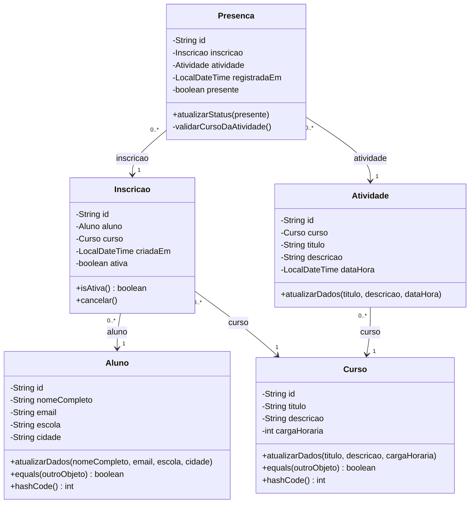
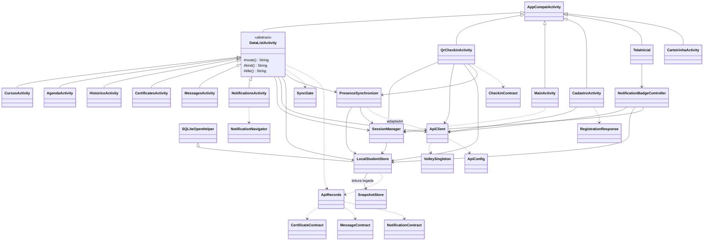

# Diagrama de classes da Entrega 2

Os diagramas mostram as relações existentes nos arquivos Java da Entrega 2. O primeiro descreve as referências entre os cinco modelos. O segundo mostra as classes que operam o fluxo Android integrado. As multiplicidades do primeiro diagrama descrevem referências Java, sem substituir as restrições SQL.

## Modelos Java

[Pacote de modelos](../src/Entrega%202/Frontend2.0/app/src/main/java/com/example/projetopi/model/)

## Fluxos Android

As telas integradas usam `JSONObject` e `JSONArray` validados. O código de login em `MainActivity` usa `HttpURLConnection`. As demais requisições representadas por `ApiClient` usam Volley. `CarteirinhaActivity` existe como tela com conteúdo demonstrativo.

## Correspondência com a API e o SQLite

| Recurso | Representação verificada |
| --- | --- |
| Aluno, curso, atividade, inscrição e presença | Modelos Java declarados. No fluxo integrado, a API usa módulos JavaScript e consulta `alunos`, `cursos`, `atividades`, `inscricoes` e `presencas`. |
| Certificado | `CertificatesActivity`, `CertificateContract`, módulo `certificadosModel` e tabelas `certificados` e `certificado_criterios`. Consulta de metadados. |
| Mensagem | `MessagesActivity`, `MessageContract`, módulo `mensagensModel` e tabelas `mensagens` e `mensagem_destinatarios`. |
| Notificação | `NotificationsActivity`, `NotificationContract`, módulo `notificacoesModel` e tabela `notificacoes`. Central interna. |
| Card e teste de perfil | `cards`, `testes_perfil`, `perguntas`, `alternativas`, `resultados_perfil` e `resultado_respostas` estão no esquema. As respectivas integrações permanecem pendentes. |

- [README da UC](../documentos/Entrega%202/Programa%C3%A7%C3%A3o%20Orientada%20a%20Objetos%20e%20Estrutura%20de%20Dados/README.md)
- [Código Android](../src/Entrega%202/Frontend2.0/app/src/main/java/com/example/projetopi/)
- [Esquema SQLite](../src/Entrega%202/Backend2.0/database/schema.sql)
- [Contratos REST](API_REST_ENTREGA2.md)
